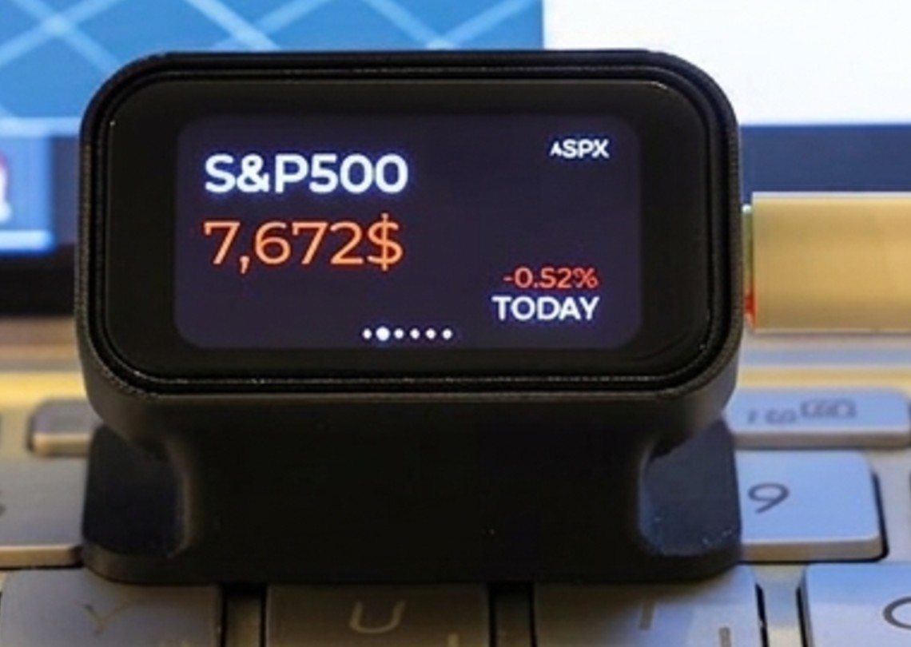
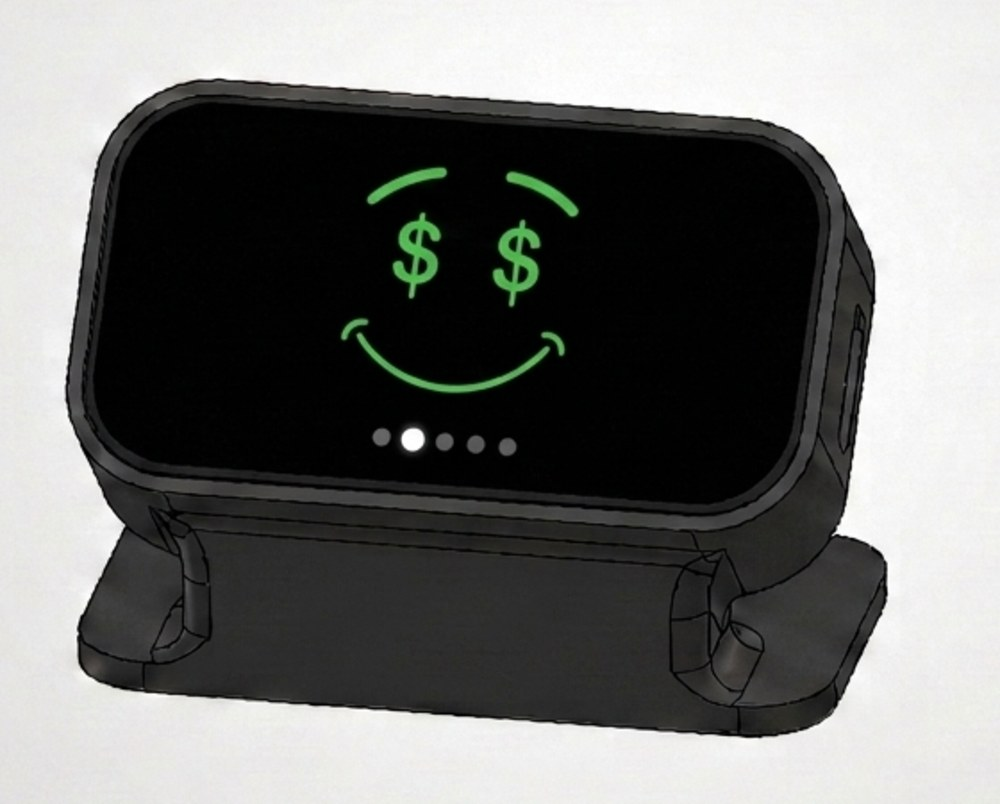
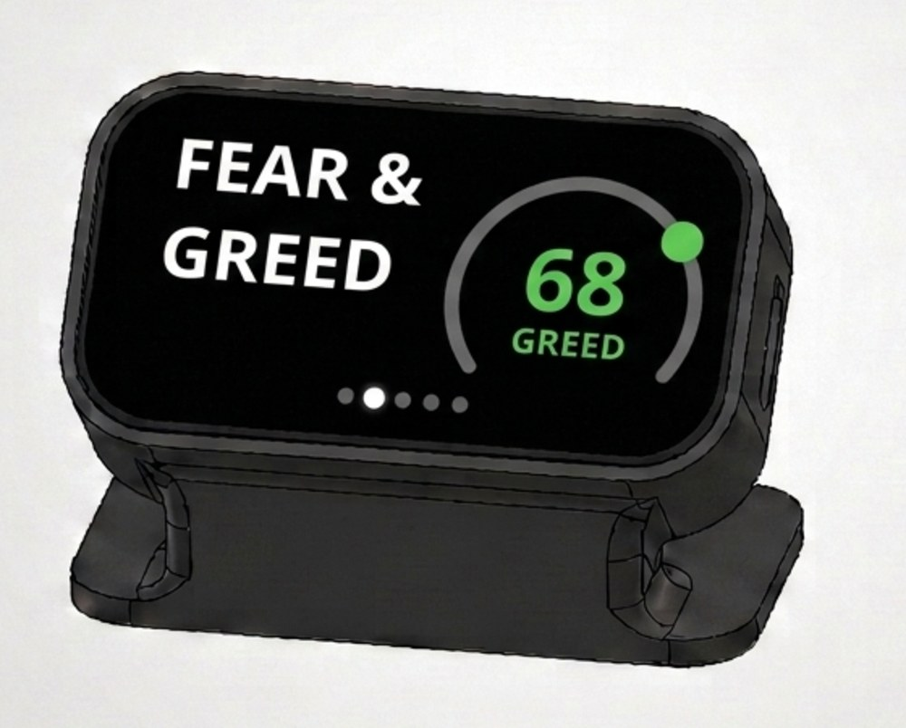
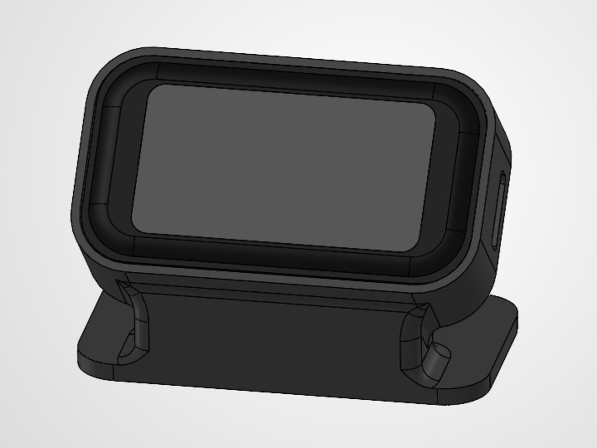
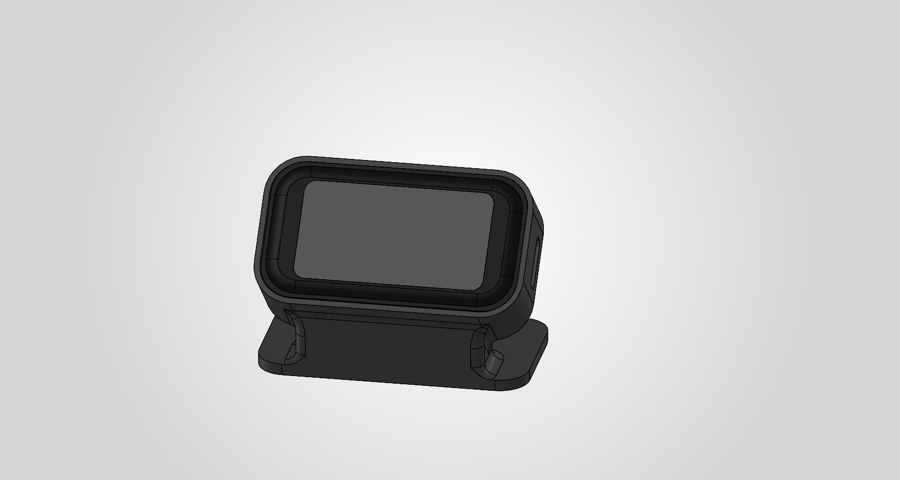

# Figo

A small desk companion that watches the market for you. Figo shows live prices
on a rotating set of screens (a stock index, a crypto pair, gold, a Fear & Greed
gauge, or anything you pick) and a face that reacts to how one instrument has
moved over the last 24 hours: pleased when it is up, worried when it is down.

You set it up and control it from a web page on your phone. There is no app, no
account, no server and no soldering: one ready-made touch-screen board in a
3D-printed stand.

<p align="center">
  
</p>

<table>
  <tr>
    <td align="center"><br><sub>Bullish (render)</sub></td>
    <td align="center"><br><sub>Fear &amp; Greed (render)</sub></td>
    <td align="center"><br><sub>The stand (render)</sub></td>
  </tr>
</table>

## 1. What to buy

| Item | Notes |
| --- | --- |
| **Waveshare ESP32-C6-Touch-LCD-1.47** | The board with the **touch** screen. Check the product page: display **JD9853** (172 x 320), touch **AXS5106L**, **8 MB** flash. Waveshare sells a sibling board with ST7789 / CST816S chips; Figo does **not** run on that one. |
| USB-C cable | Must carry **data**, not just power. |
| USB power | Any phone charger or computer port. |
| PLA filament and a 3D printer | Yours, a friend's, or a print service. |

You also need a computer with the Arduino IDE 2.x (or an AI coding agent, see
below), a phone, and a **2.4 GHz** WiFi network (the ESP32-C6 cannot see 5 GHz).
No screws, glue or API keys are needed.

## 2. What to 3D print

Print one part: [`design/Figo.3mf`](design/Figo.3mf), a Bambu Studio project
with the settings already in it. OrcaSlicer opens it too. For any other slicer,
import the shape and enter these settings:

| Setting | Value |
| --- | --- |
| Printer | Bambu Lab A1, 0.4 mm nozzle |
| Profile | 0.20 mm Standard |
| Material | PLA, 220 &deg;C nozzle, 65 &deg;C bed |
| Walls / top / bottom | 2 / 5 / 3 |
| Infill | 15 %, grid |
| Supports | **Off** |
| Orientation | Standing on its base, as it sits on a desk |

<p align="center">
  
</p>

**Do not put the board in the stand yet.** Once it is inside, the BOOT button
cannot be reached, and the stand is a press fit that is not meant to come apart
again and again. Flash first (step 3), assemble after (step 4).

## 3. Put the firmware on the board

### Option A: let an AI agent do it (Claude Code, Codex, ...)

Clone this repository, open it in your agent, plug the board into your computer
with the USB-C data cable, and paste:

```text
Build the Figo firmware in this repository and flash it to my Waveshare
ESP32-C6-Touch-LCD-1.47, which is plugged in over USB. Do not change any files.

1. Install arduino-cli if it is missing. Add the board index
   https://espressif.github.io/arduino-esp32/package_esp32_index.json and
   install the core esp32:esp32 version 3.3.11.
2. Install these libraries at exactly these versions:
   lvgl 8.4.0 (NOT 9.x), ArduinoJson 7.4.3, ESP Async WebServer 3.12.0 and
   Async TCP 3.5.0 (both by ESP32Async, not the me-no-dev copies),
   GFX Library for Arduino 1.6.7.
3. Compile the sketch folder ./Figo with:
   --fqbn "esp32:esp32:esp32c6:FlashSize=8M,PartitionScheme=default_8MB,CDCOnBoot=cdc"
   All three options are required: a 4 MB flash size or the default partition
   scheme fails at link time with "text section exceeds available space", and
   without CDCOnBoot=cdc the USB serial log is silent. Pass --libraries
   explicitly, and reuse one --build-path. The first build takes 15-25 minutes
   and prints very little; that is normal.
4. List the serial ports, tell me which one is the board, and upload.
   If the upload cannot connect, ask me to hold BOOT, tap RESET, and release
   BOOT, then retry.
5. Open the serial monitor at 115200 baud, press RESET, and confirm the
   greeting screen and then a "join Figo-Setup" screen appear. Report what you see.
```

### Option B: Arduino IDE

1. Install **Arduino IDE 2.x**. In **File > Preferences**, add
   `https://espressif.github.io/arduino-esp32/package_esp32_index.json` to
   *Additional boards manager URLs*. In **Boards Manager**, install
   **esp32 by Espressif Systems 3.3.11**.
2. In **Library Manager**, install exactly:

   | Library | Version |
   | --- | --- |
   | lvgl (kisvegabor) | **8.4.0** (not 9.x) |
   | ArduinoJson (Benoit Blanchon) | 7.x (tested 7.4.3) |
   | ESP Async WebServer (**ESP32Async**) | 3.12.0 |
   | Async TCP (**ESP32Async**) | 3.5.0 |
   | GFX Library for Arduino (Moon On Our Nation) | 1.6.7 |

   If the manager offers to install dependencies and lists an ESP8266 or
   `me-no-dev` library, choose *install without dependencies*.
3. Open `Figo/Figo.ino`. Keep every file where it is: `lv_conf.h` and
   `build_opt.h` must stay beside `Figo.ino`.
4. Set the **Tools** menu:

   | Entry | Value |
   | --- | --- |
   | Board | ESP32C6 Dev Module |
   | Port | the board's port |
   | **Flash Size** | **8MB (64Mb)** |
   | **Partition Scheme** | **8M with spiffs (3MB APP/1.5MB SPIFFS)** |
   | **USB CDC On Boot** | **Enabled** |

   Wrong flash settings fail at the very end of the build with `text section
   exceeds available space` (a "127%" figure). It looks like the firmware is too
   big; it is only the partition setting.
5. Click **Upload**. The first build takes 15 to 25 minutes and shows very
   little; later builds take about a minute.
6. If the upload cannot connect: hold **BOOT**, tap **RESET**, release **BOOT**,
   and upload again.

When it works, the screen shows a greeting, then asks you to join the
`Figo-Setup` WiFi network.

## 4. Assemble

Unplug the board. With the screen facing you and the USB-C port toward the
opening on the stand's **right-hand side**, press the board into the front of
the stand until it seats. Plug the cable back in through the side opening. The
small hole marked RST lines up with the board's reset button.

To take the board out again, lift it by the glass with a suction cup (the kind
sold for phone-screen repair). Do not lever against the glass.

## 5. First switch-on

1. On your phone, join the WiFi network **Figo-Setup** (password `figo1234`).
   The setup page usually opens by itself; if not, browse to `http://192.168.4.1`.
2. Pick your home 2.4 GHz network, type its password, tap **Connect**.
3. From then on, open **http://figo.local** on any phone or computer on the same
   WiFi. If `.local` names do not work on your phone, use Figo's address from
   your router's device list.

A new Figo shows a face, then the S&P 500, Bitcoin and Ethereum, gold and the
CNN Fear & Greed index, moving on every 8 seconds. Swipe the glass to move
yourself.

## Using it

- **Screens:** add, remove, reorder (hold and drag) and edit screens from your
  phone: stocks, crypto, commodities, Fear & Greed. You can search for
  instruments by name.
- **The star:** the face follows the screen you star. A new Figo stars Bitcoin,
  because crypto trades around the clock.
- **The face:** *Bullish* at +5 % or more over 24 hours, *Happy* at +1 % or more,
  *Neutral* in between, *Panicked* at -2.5 % or worse. The thresholds are in
  **Settings > Advanced**; lower them if you star a calmer instrument such as an
  index.
- **Settings:** brightness (10 to 100 %), orientation, and a night window during
  which Figo dims and sleeps.
- **Updating:** build the sketch, then on the phone open
  **Settings > Update** and choose `Figo.ino.bin` from the build folder
  (never `Figo.ino.merged.bin`). A version that does not start properly is
  reverted automatically. `http://figo.local/update` is a plain fallback page.
- **Start over:** **Settings > Advanced > Start over** erases the settings and
  the saved WiFi.

The detailed [Build & Use Guide](docs/guide/Figo-Guide.pdf) covers every step
with screenshots, troubleshooting and the settings reference. There is also a
one-page [Quick Reference](docs/guide/Figo-QRH.pdf) ([Hebrew](docs/guide/Figo-QRH-he.pdf)).

## Troubleshooting

| Symptom | Fix |
| --- | --- |
| No port appears | The USB cable is charge-only. Use a data cable. |
| Build fails with hundreds of `lv_...` errors | Wrong LVGL. Install 8.4.0, not 9.x. |
| Build fails at the end with "127%" | Set Flash Size 8MB and the 8M partition scheme. |
| Serial monitor is empty | Enable USB CDC On Boot and re-upload. |
| Figo-Setup opens but the setup page does not | Browse to `http://192.168.4.1` while still on Figo-Setup. |
| Your network is missing from the list | Figo only sees 2.4 GHz networks. Tap *Scan again* or type the name. |
| `figo.local` does not open | Some Android phones lack `.local` support. Use Figo's address from Settings or your router. |
| The face is always Neutral | The starred screen has no fresh data, or the thresholds are too wide for it. |
| Prices show `--` | Give it a minute or two after switching on. Check the WiFi. |

## Repository layout

```
Figo/                 Arduino sketch (open Figo/Figo.ino)
  data/               Source of the phone page (HTML, CSS, JS)
  WebAssets.h         The phone page, compiled into the firmware
  tools/embed-spa/    Regenerates WebAssets.h after you edit data/
design/               Stand print file and render
docs/guide/           PDF guides and photos
```

The phone page is part of the firmware; there is no filesystem image to upload.
After editing anything in `Figo/data/`, regenerate it before building (needs
Node.js):

```
node Figo/tools/embed-spa/embed.mjs
```

## License

MIT, see [LICENSE](LICENSE).

## Disclaimer

Figo's source code is released under the MIT license. That license covers this
repository only: the market data Figo displays is retrieved at runtime from
third-party APIs (Yahoo Finance, CoinGecko) and remains subject to each
provider's own terms of service and rate limits. You are responsible for using
those services in line with their terms.

The data shown is informational only. It is not financial advice, and it may be
delayed or inaccurate. Figo is an independent project and is not affiliated
with, endorsed by, or sponsored by Yahoo or CoinGecko.
